# Kervax

Self-hosted infrastructure monitoring with a built-in security audit. Sites, servers, Docker,
Kubernetes, databases, queues, GPUs and backups in one panel, ready after a single command.
Open source under AGPL-3.0. Your data stays in your Postgres.

[Русская версия](README.ru.md) · [kervax.ru](https://kervax.ru) · [Install guide](docs/install.md) · [Security model](docs/security.en.md) · [Changelog](CHANGELOG.md)

```bash
curl -fsSL https://raw.githubusercontent.com/mihsergeev/Kervax/main/ops/quickstart.sh | sudo sh
```

Installs Docker if missing, starts Caddy with a Let's Encrypt certificate, generates secrets and
prints the panel address with the admin password. Without a domain it runs on `<server-ip>.sslip.io`.

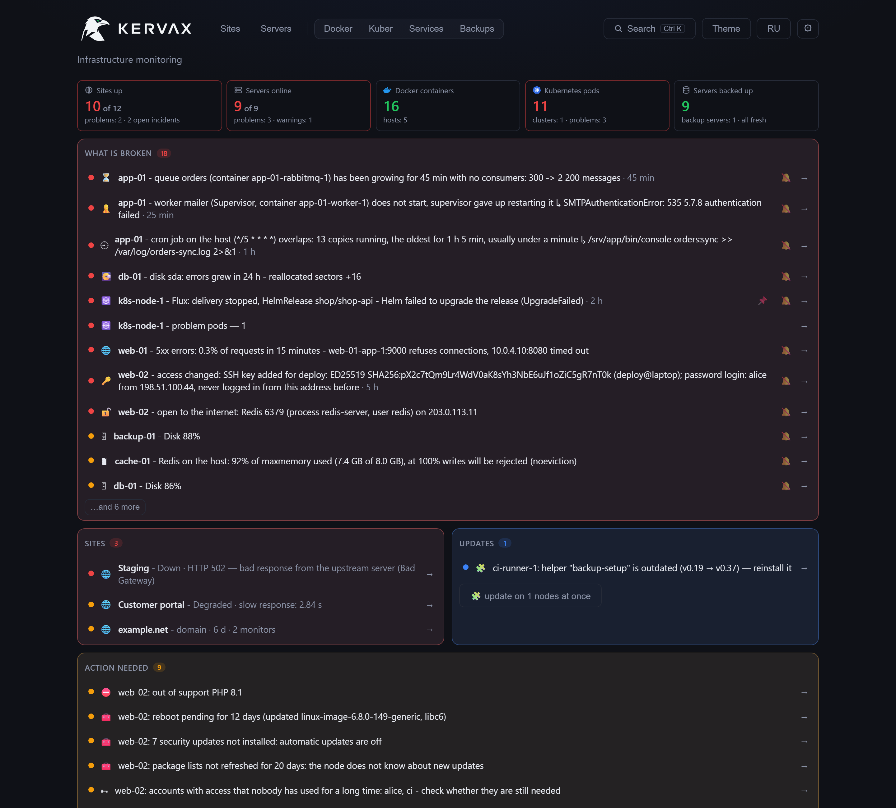

| | |
| --- | --- |
| **Out of the box** | One command for the panel, one per node. No exporters, scrape configs, rules or dashboards to build. |
| **Agent** | Static Go binary, outbound HTTPS only, no listening port, unprivileged user, systemd sandbox. |
| **80 alert types** | Sustain windows, hysteresis, one message per problem, storm merging, daily routine suppression. |
| **Security audit** | External port scan, SSH and account audit, critical CVEs (CISA KEV), EOL software, container risks. |
| **Self-hosted** | No SaaS, no telemetry. PostgreSQL, Docker Compose, 2 GB of RAM. |
| **Open source** | AGPL-3.0. Signed agent releases, role checks enforced in the API, CI self-checks. |

---

## Security audit

<table>
<tr>
<td width="50%"><a href="docs/img/security-ports.png">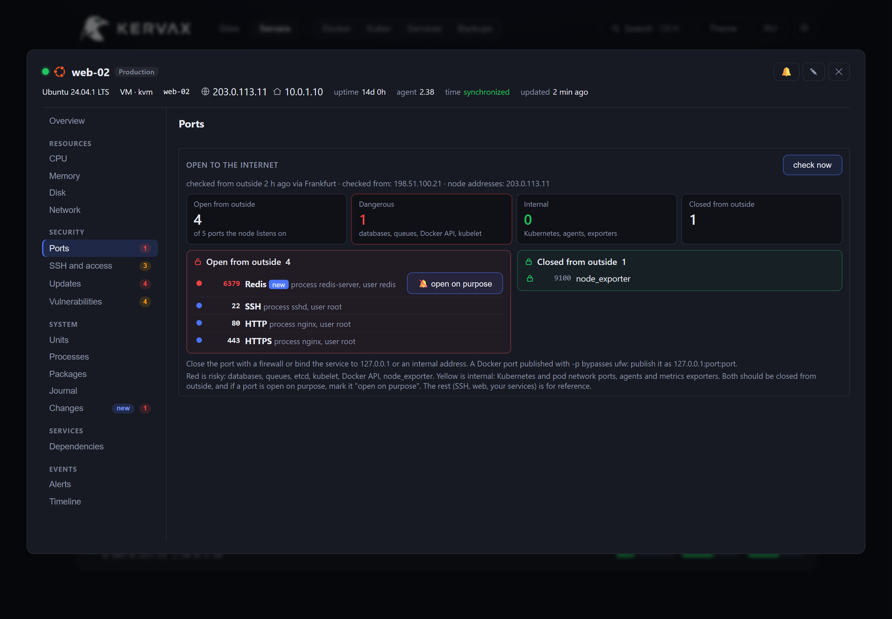</a><br><sub>Ports reachable from the internet, checked from outside</sub></td>
<td width="50%"><a href="docs/img/security-access.png">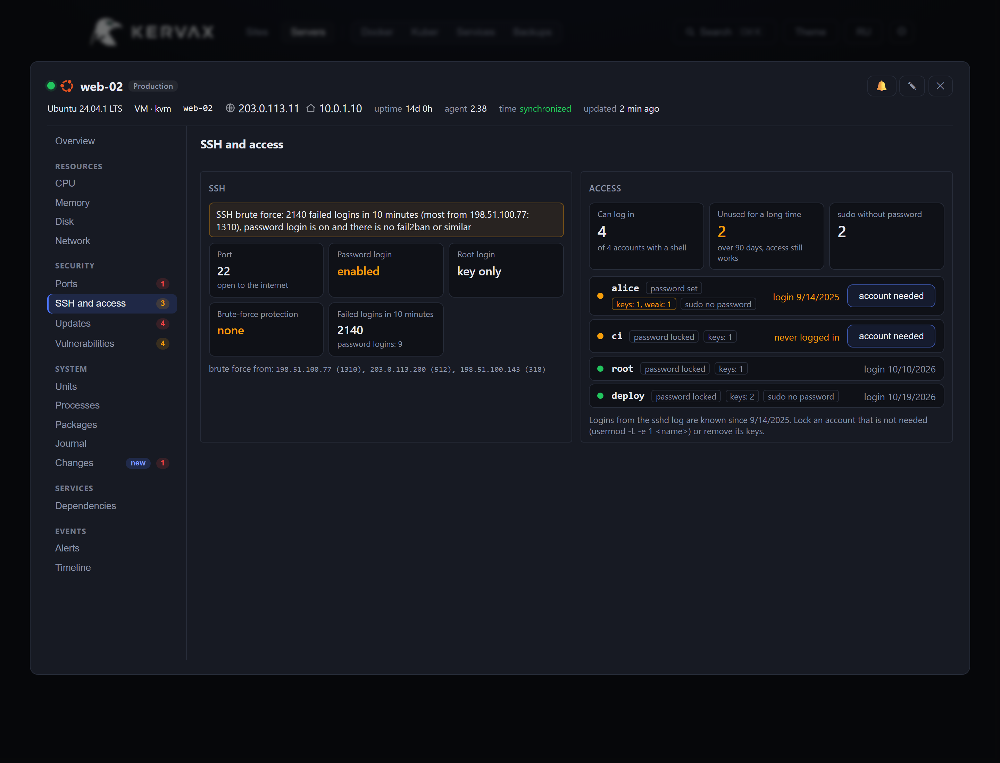</a><br><sub>SSH, accounts, keys, sudo</sub></td>
</tr>
</table>

- **Open ports.** The panel scans every node from outside and matches the result against what
  listens inside. Each open port is listed with its process and container. A port open only to an
  allowlist is not reported as exposed. Origins that must answer only Cloudflare are verified.
  A new port on the internet raises an alert; an intended one is marked once.
- **SSH.** Password login, root login, ports, brute-force protection, version banner disclosure.
  Judged only for ports the external scan sees open.
- **Accounts and keys.** Who can log in, with which keys, who has sudo, weak keys, accounts nobody
  uses. New users, keys and sudo rules raise an alert.
- **Changes.** Added and removed listening ports, containers, users, sudoers entries and cron jobs,
  in a 90-day server timeline.
- **Vulnerabilities.** Installed packages against the Canonical OVAL feed. Only critical CVEs and
  those in CISA KEV (exploited in the wild). The kernel is checked by the running version.
- **End of life.** OS releases and software versions (PostgreSQL, MySQL, Redis, nginx, PHP, Node.js,
  Python and more) against endoflife.date, shipped offline.
- **Containers.** Privileged containers, host keys and the Docker socket mounted inside, ports
  published past the host firewall, outdated reverse proxy images. A reverse proxy holding the
  Docker socket gets a ready fix: a helper edits a copy of its compose file on the node (secrets
  never leave it), checks it with `docker compose config`, and the panel shows the diff with the
  commands to apply and roll back.
- **Web servers.** Certificates served by nginx, `nginx -t` every 15 minutes: a broken config is
  reported before the next reload takes the sites down.
- **The panel itself.** Login throttling with an allowlist, alert on rejected and flooding API
  requests, TOTP, audit log of every action.

<a href="docs/img/sockfix.png">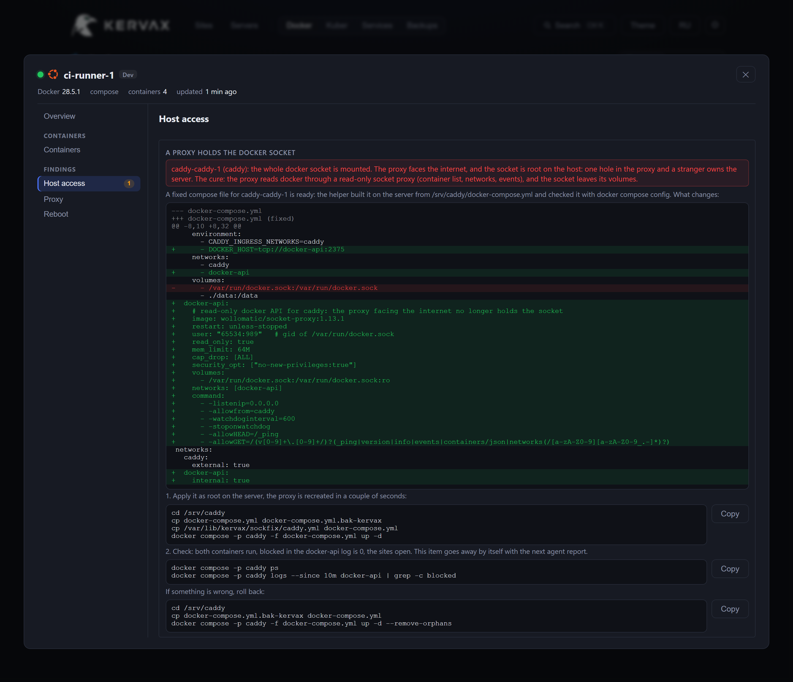</a>
<sub>A proxy holds the Docker socket: the fixed compose file is already built on the node</sub>

<table>
<tr>
<td width="50%"><a href="docs/img/vulns.png">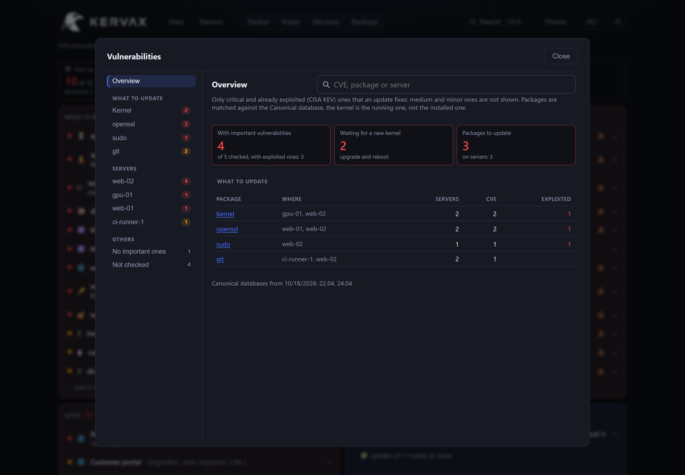</a><br><sub>Vulnerabilities across the fleet: critical and CISA KEV only</sub></td>
<td width="50%"><a href="docs/img/server.png">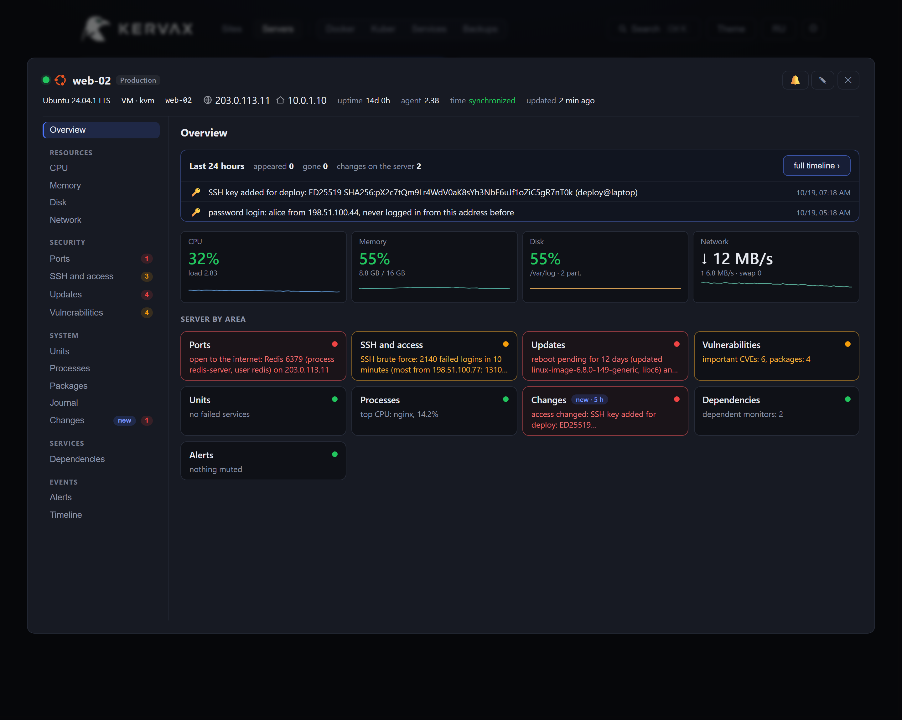</a><br><sub>Server card: findings mapped by area, last 24 hours of changes on top</sub></td>
</tr>
</table>

## Disks and hardware

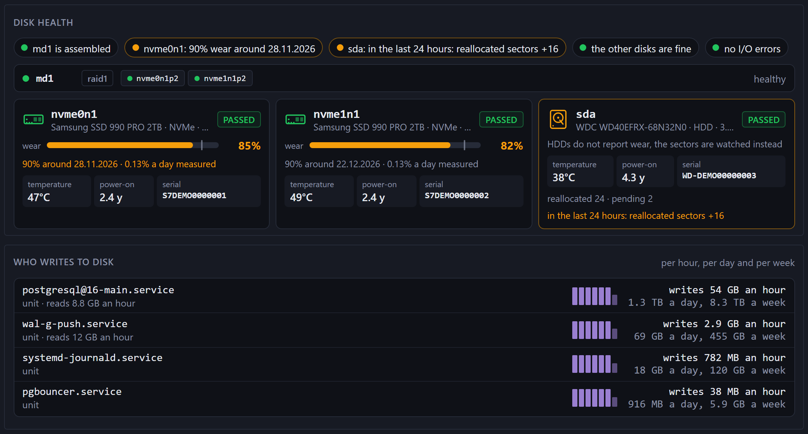

- **SSD wear forecast.** NVMe and SATA wear, the date it reaches 100% at the current write rate,
  alert 60 days ahead, the processes and containers that write the most.
- **Disk health.** Degraded RAID, SMART failures, growing error counters, disks that disappeared,
  I/O error bursts in the kernel log, disks of virtual machines.
- **Fill forecast.** Days until a filesystem is full, from daily minima rather than spikes; inodes
  separately.
- **Where the space went.** Largest directories, journal, Docker images and build cache, oversized
  logs. Safe items are freed with one click; optional auto-cleanup at the warning threshold.
- **CPU and memory.** Usage by container and pod (cgroups), memory leaks by steady growth, OOM
  kills, pressure stall (PSI), units in a restart loop, units that will not start after reboot.
- **Network.** TCP checks between servers, traffic per container, monthly traffic against the
  tariff limit, DNS resolver latency, clock drift.
- **GPU and LLM.** NVIDIA utilization, memory, temperature, power, Xid errors that need a reset,
  frozen readings. vLLM, SGLang, TEI and LiteLLM: queue, KV cache, time to first token.

<table>
<tr>
<td width="50%"><a href="docs/img/disks.png">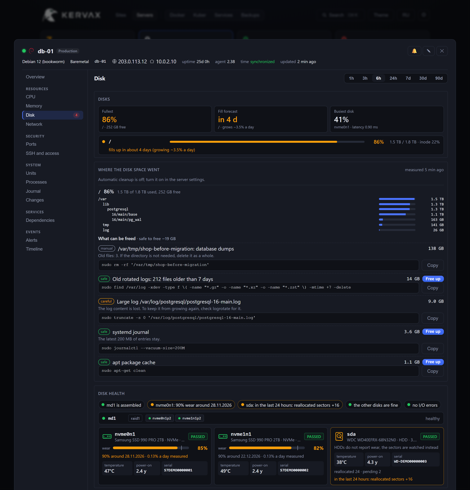</a><br><sub>Fill forecast and where the space went, safe items freed with a click</sub></td>
<td width="50%"><a href="docs/img/gpu.png">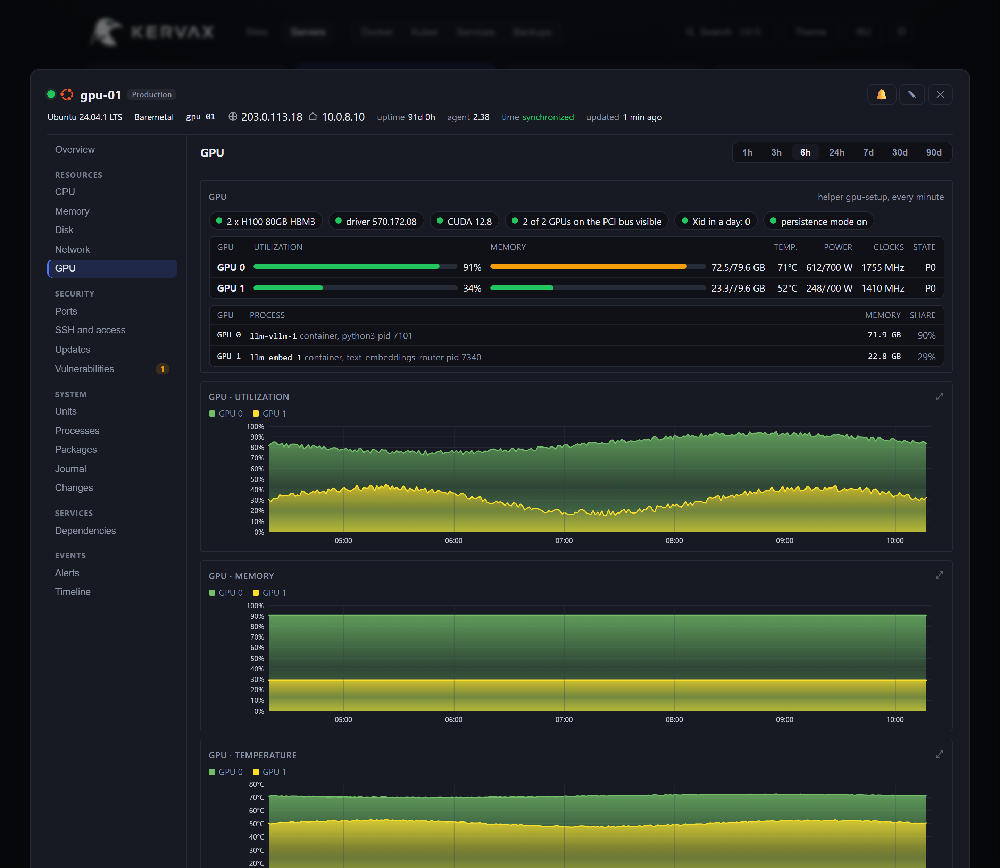</a><br><sub>GPUs: utilization, memory, temperature, power, processes</sub></td>
</tr>
</table>

## Services

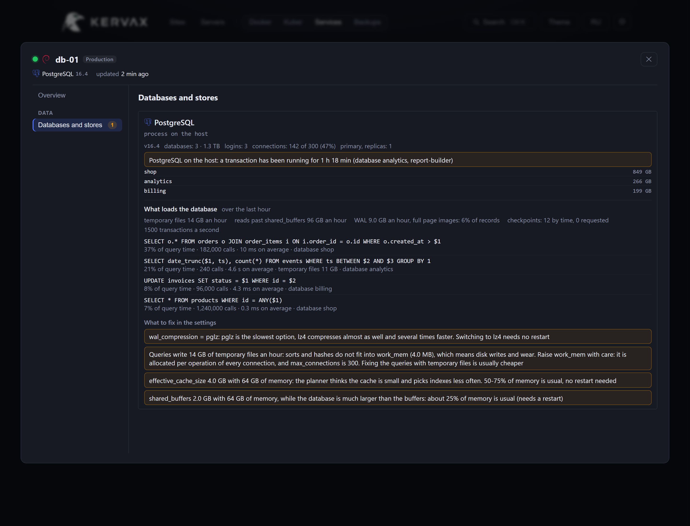

Discovered by the agent, no configuration per service.

- **Docker and Kubernetes.** Containers, pods, restarts, CrashLoopBackOff, failed Jobs with the
  end of their log, pods without limits or probes, node pressure.
- **Kubernetes expiry.** Control-plane and kubelet certificates, kubeconfigs, TLS secrets, Flux Git
  credentials; Flux delivery that stopped. Computed on the node, no key material leaves it.
- **Web servers.** nginx, Apache, Caddy, Traefik, Envoy, HAProxy and the domains they serve.
  Requests per minute and 5xx per site and path. For 502/504: which upstream failed and how
  (refused, timed out, no live upstreams, socket queue full).
- **Databases.** PostgreSQL, MySQL/MariaDB, ClickHouse, Redis: sizes, connections, top queries by
  load, replication, configuration advice.
- **Queues.** RabbitMQ, Redis lists, job tables in PostgreSQL and MySQL: depth, consumers, age of
  the oldest job, failed job spikes. Alert when a queue grows and nobody drains it.
- **Workers, cron, logs, PHP-FPM.** supervisor and pm2 crash loops vs planned restarts; cron jobs
  that overlap, hang or discard output; error spikes in container and pod logs; PHP-FPM pools hitting
  `pm.max_children` or timing out.

<table>
<tr>
<td width="50%"><a href="docs/img/services-app.png">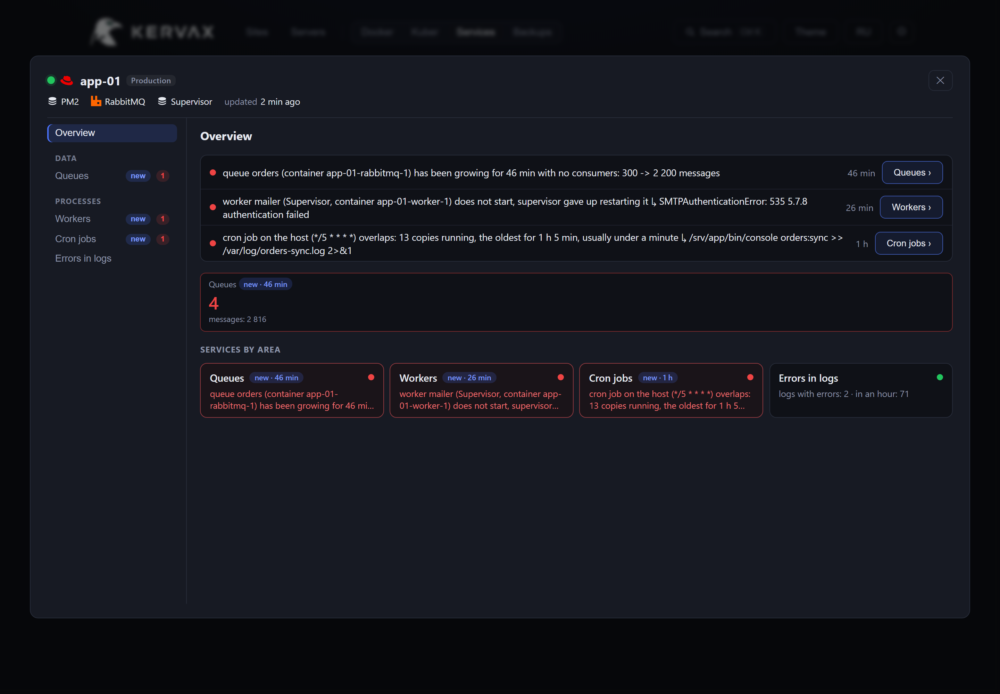</a><br><sub>Queues, workers and cron jobs: what is stuck and why</sub></td>
<td width="50%"><a href="docs/img/kube.png">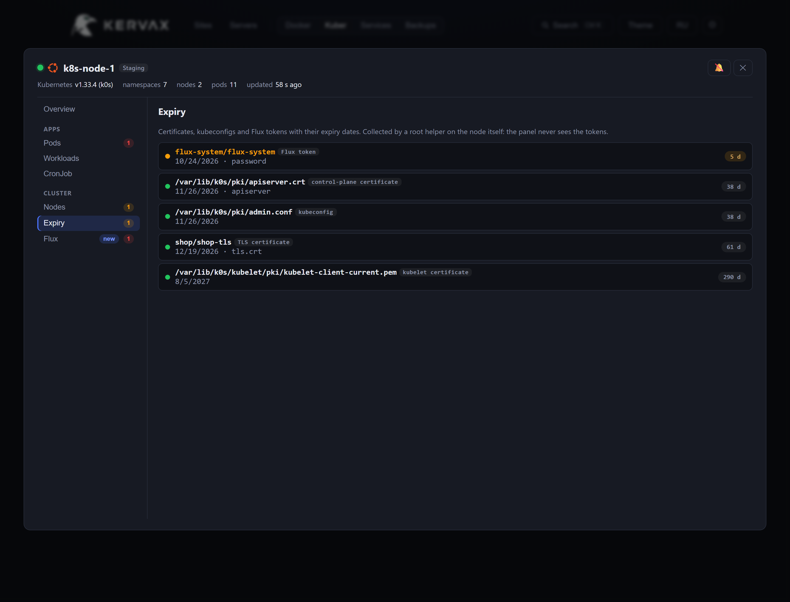</a><br><sub>Kubernetes: certificate, kubeconfig and Flux token expiry</sub></td>
</tr>
</table>

<table>
<tr>
<td width="50%"><a href="docs/img/web.png">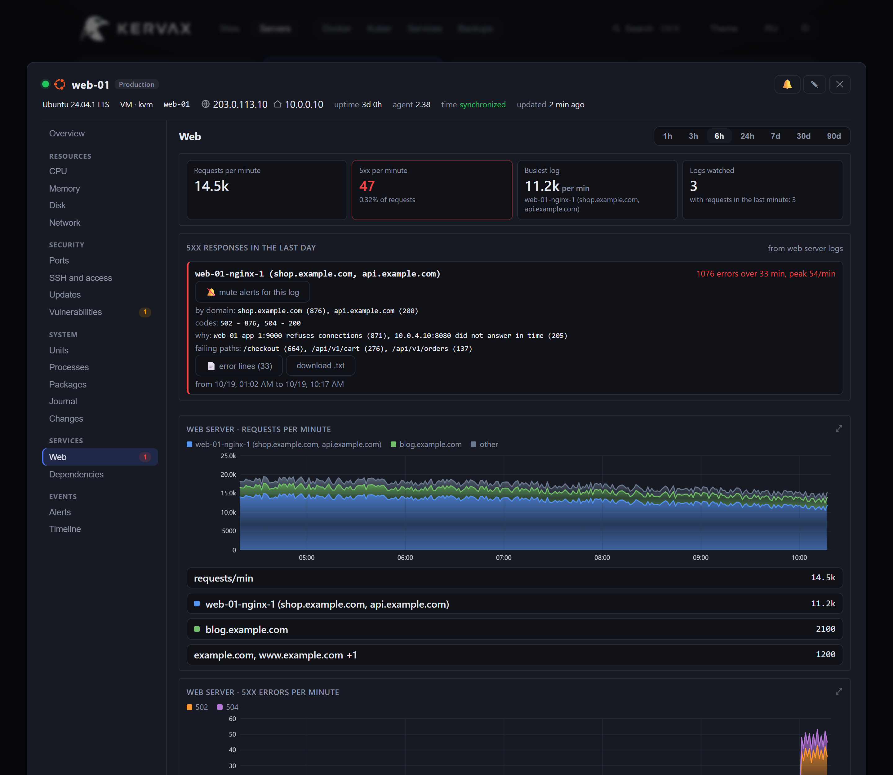</a><br><sub>Web: 5xx by site and path, the upstream that failed and how</sub></td>
<td width="50%"><a href="docs/img/llm.png">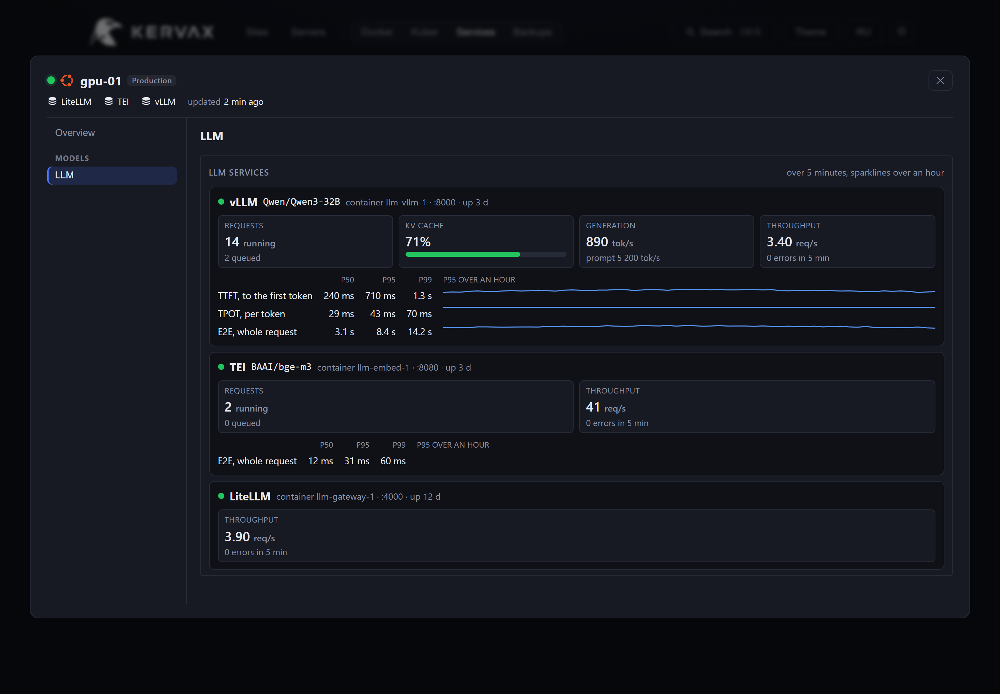</a><br><sub>LLM serving: queue, KV cache, TTFT and TPOT percentiles</sub></td>
</tr>
</table>

## Sites

<table>
<tr>
<td width="50%"><a href="docs/img/sites.png">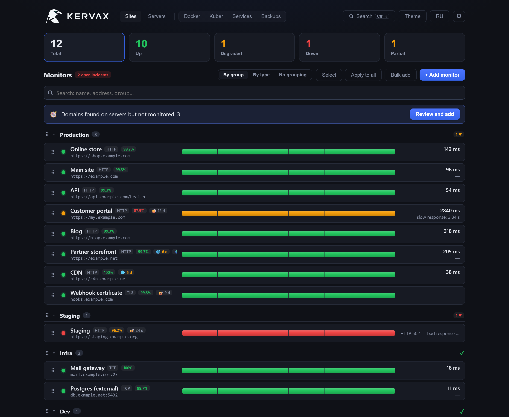</a><br><sub>Monitors: status, certificates, domains, locations</sub></td>
<td width="50%"><a href="docs/img/site-detail.png">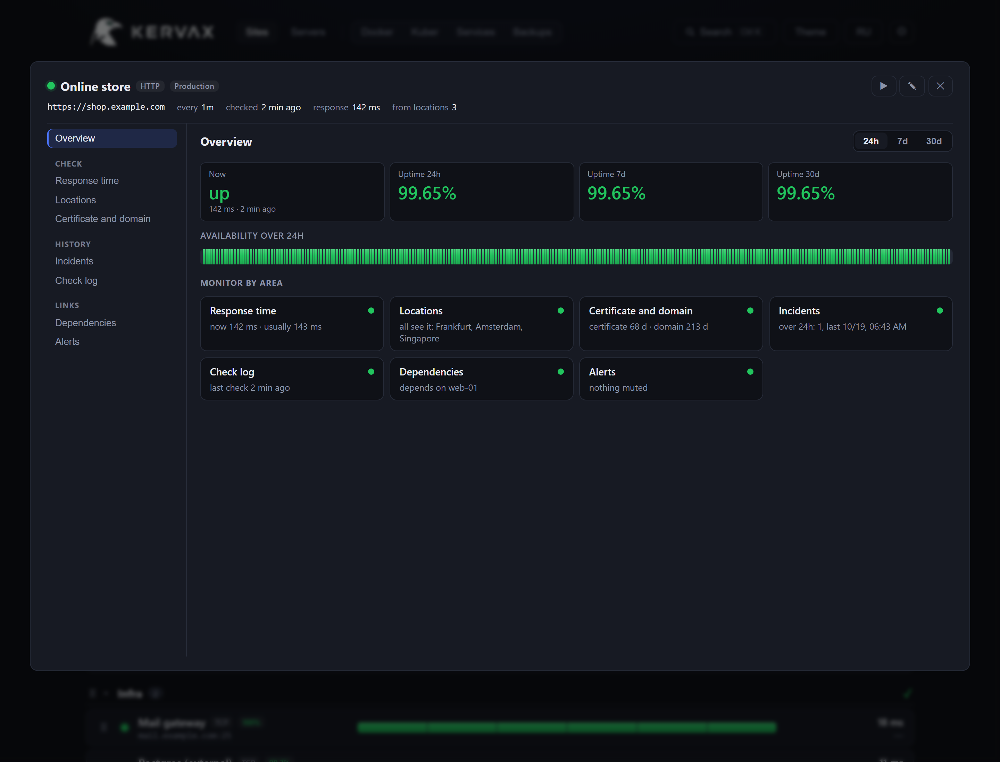</a><br><sub>Monitor card: latency per location, incidents</sub></td>
</tr>
</table>

- HTTP(S) with expected status and keyword, TCP, DNS records, push (heartbeat) monitors.
- Checks from proxy locations in other networks: "down from Singapore" is a separate state.
- TLS and domain registration expiry, grouped by the domain you renew.
- Sites behind an IP allowlist are checked by the agent from inside the server.
- Flaky detection: a site that fails every other request is reported as such.

## Backups

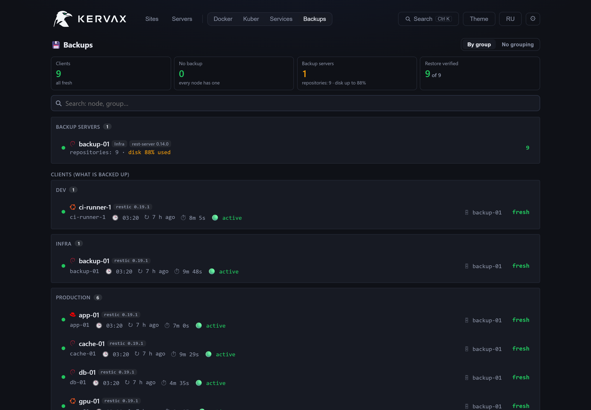

- restic on every node: last snapshot, result, night window, size added per run.
- Weekly test restore, stale repository locks, rotation that silently stopped.
- Backup server and clients deployed from the panel; DB dumps before each run.
- Restore credentials in a vault encrypted in the browser: the panel stores only ciphertext.

## Alerts

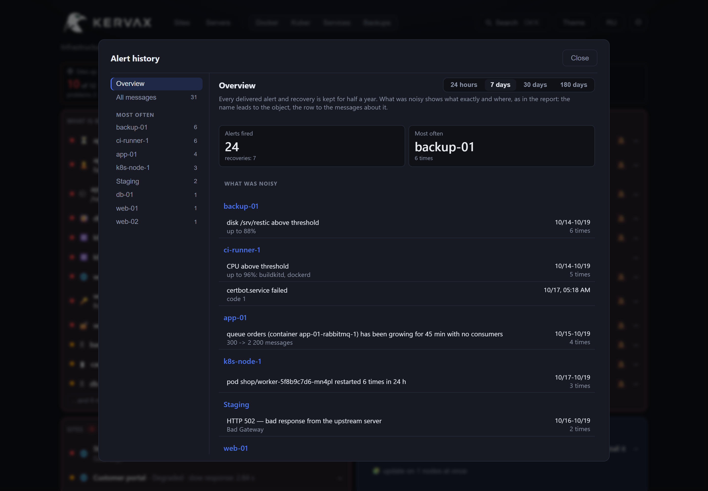

- Telegram with action buttons (mute, ack, "this is us") and bot commands; webhook.
- Routes per group to separate chats, escalation when nobody acks.
- Maintenance windows with a check after the window, dependency map: alerts of servers behind a
  dead gateway are held.
- One message per problem; one message when the same failure hits several servers; daily routine
  (a nightly backup that loads the disk) is recognized and not alerted.
- Alert history with a noise ranking; period report with downtime per day.

## Security model

- The agent connects **out** over HTTPS. The panel never connects into your servers and stores
  only a SHA-256 of each agent token.
- Roles and groups are enforced in the API. `ops/audit_live.py` probes a running panel with
  temporary accounts of each role; `ops/selfcheck.py` runs in CI and as a pre-commit hook.
- Nothing runs as root: backend uid 10001, unprivileged nginx frontend, `no-new-privileges`.
- The panel refuses to start with a default or weak secret. Passwords of 12+ characters, TOTP,
  login throttling, audit log.
- Agent updates are signed with an **offline** key. A compromised panel cannot push code to nodes.
- Root helpers on nodes are installed by your own Ansible or by hand, never pushed by the panel.

Threat model: [docs/security.en.md](docs/security.en.md).

## Kervax vs. a Prometheus stack

| Task | Kervax | Typical stack |
| --- | --- | --- |
| Metrics from a new server | one command on the node | node_exporter, scrape target, reload, dashboard |
| Site from outside | the address | blackbox_exporter, relabeling, rule, panel |
| TLS and domain expiry | automatic, 14/7/1 days | blackbox probe + PromQL; domains need a custom exporter |
| Ports open to the internet | external scan, alert on new | separate scanner |
| CVEs and EOL software | per node, in the card | separate tooling |
| SSD wear, SMART, RAID | per disk, with forecast | smartctl_exporter + rules |
| Containers, pods, DBs, queues | discovered by the agent | cAdvisor, kube-state-metrics, per-DB exporters |
| Backups | restic status and test restore | not covered |
| Incidents and routing | built in | Alertmanager configuration |
| Access control | roles and groups in the API | Grafana orgs + Prometheus access |

Prometheus remains the tool for application metrics and ad-hoc PromQL; both run side by side.
[What Kervax deliberately does not do](docs/why.md).

## Requirements

- Linux with Docker and Compose, 2 GB RAM, ports 80 and 443 (or your reverse proxy).
- Agent: Linux x86-64 or arm64, systemd.
- No external services.

## Install and configure

[docs/install.md](docs/install.md): own domain, allowlist, existing reverse proxy, upgrades.
Configuration is `KERVAX_*` environment variables, see [.env.example](.env.example).

## Scaling

One container handles a few hundred servers. `compose.scale.yml` runs the API as several uvicorn
workers and the scheduler as its own process:

```sh
docker compose -f compose.yml -f compose.scale.yml -f compose.caddy.yml up -d --build
```

PostgreSQL is tuned for time series in `compose.yml`; switch the image to TimescaleDB if you outgrow it.

## Signed agent updates

Off by default. Releases are signed offline; an agent installs an update only if the signature
verifies, the version is newer and the SHA-256 matches. Canary rollout from the Servers page.
[docs/agent-releases.en.md](docs/agent-releases.en.md).

## Self-monitoring

The scheduler writes a heartbeat every minute; `ops/panel-watchdog.sh` on the host alerts on its
own if the panel, scheduler, database or alert channel stops.

## Development

```sh
cd backend && python -m venv .venv && . .venv/bin/activate && pip install -e .[dev] && pytest -q
cd ../frontend && npm ci && npm run dev
```

FastAPI, SQLAlchemy 2 async, Alembic, PostgreSQL; React 19, Vite, TypeScript; agent in Go.
`python docs/make-shots.py` rebuilds the screenshots from a live panel on demo data: every name,
domain and address in them is invented (RFC 2606, RFC 5737).

## License

[AGPL-3.0](LICENSE).
