# Kervax

Self-hosted мониторинг инфраструктуры со встроенным аудитом безопасности. Сайты, серверы, Docker,
Kubernetes, базы, очереди, GPU и бэкапы в одной панели, готовой после одной команды.
Open source, AGPL-3.0. Данные остаются в вашем PostgreSQL.

[English](README.md) · [kervax.ru](https://kervax.ru) · [Установка](docs/install.ru.md) · [Модель безопасности](docs/security.md) · [Изменения](CHANGELOG.md)

```bash
curl -fsSL https://raw.githubusercontent.com/mihsergeev/Kervax/main/ops/quickstart.sh | sudo sh
```

Ставит Docker, если его нет, поднимает Caddy с сертификатом Let's Encrypt, генерирует секреты и
выводит адрес панели с паролем администратора. Без своего домена панель работает на
`<IP-сервера>.sslip.io`.

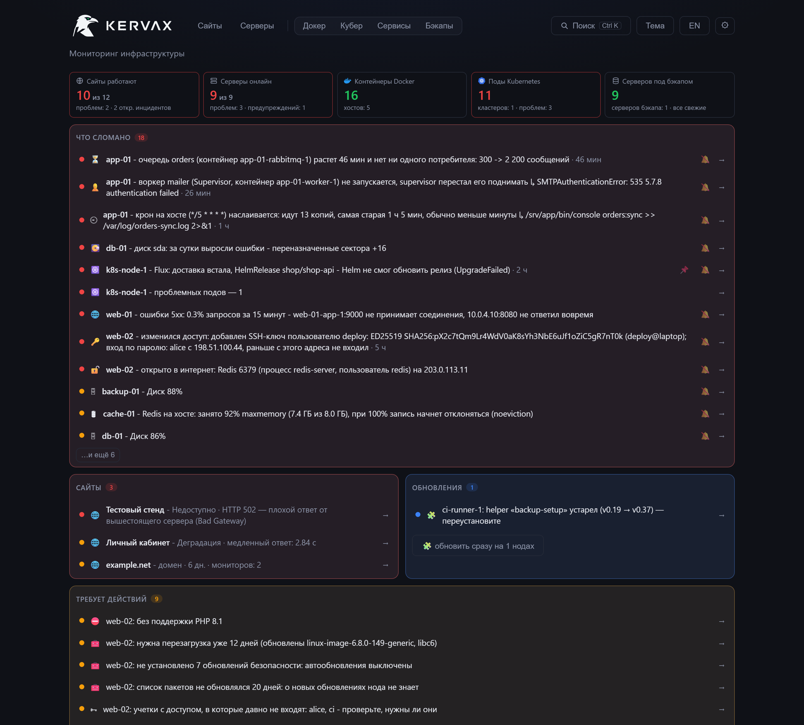

| | |
| --- | --- |
| **Из коробки** | Одна команда на панель, одна на ноду. Без экспортеров, scrape-конфигов, правил и дашбордов. |
| **Агент** | Статический бинарь на Go, только исходящий HTTPS, ни одного порта на ноде, непривилегированный пользователь, песочница systemd. |
| **80 видов алертов** | Выдержка, гистерезис, одна беда - одно сообщение, сбой на нескольких серверах - одно сообщение, плановая ежедневная нагрузка не алертит. |
| **Аудит безопасности** | Проверка портов снаружи, SSH и учетки, критичные CVE (CISA KEV), версии без поддержки, опасные контейнеры. |
| **Self-hosted** | Без SaaS и телеметрии. PostgreSQL, Docker Compose, 2 ГБ памяти. |
| **Open source** | AGPL-3.0. Подписанные релизы агента, права проверяются в API, самопроверки в CI. |

---

## Аудит безопасности

<table>
<tr>
<td width="50%"><a href="docs/img/ru/security-ports.png">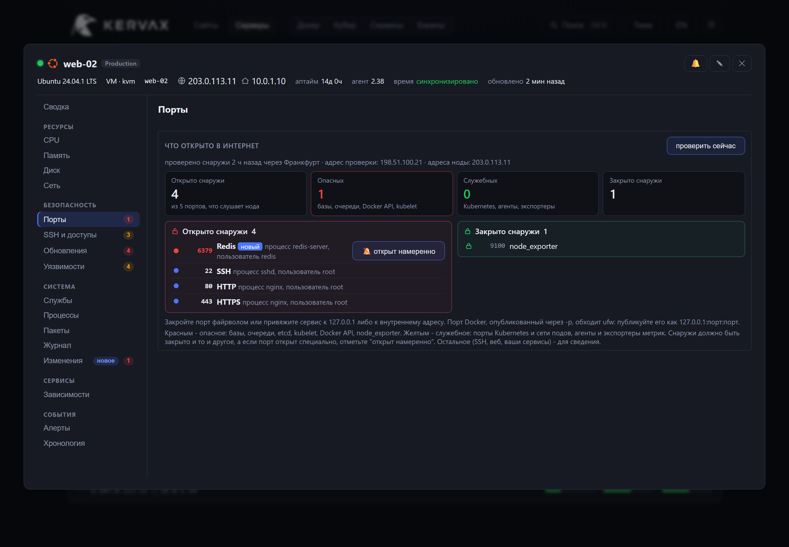</a><br><sub>Порты, открытые в интернет, по проверке снаружи</sub></td>
<td width="50%"><a href="docs/img/ru/security-access.png">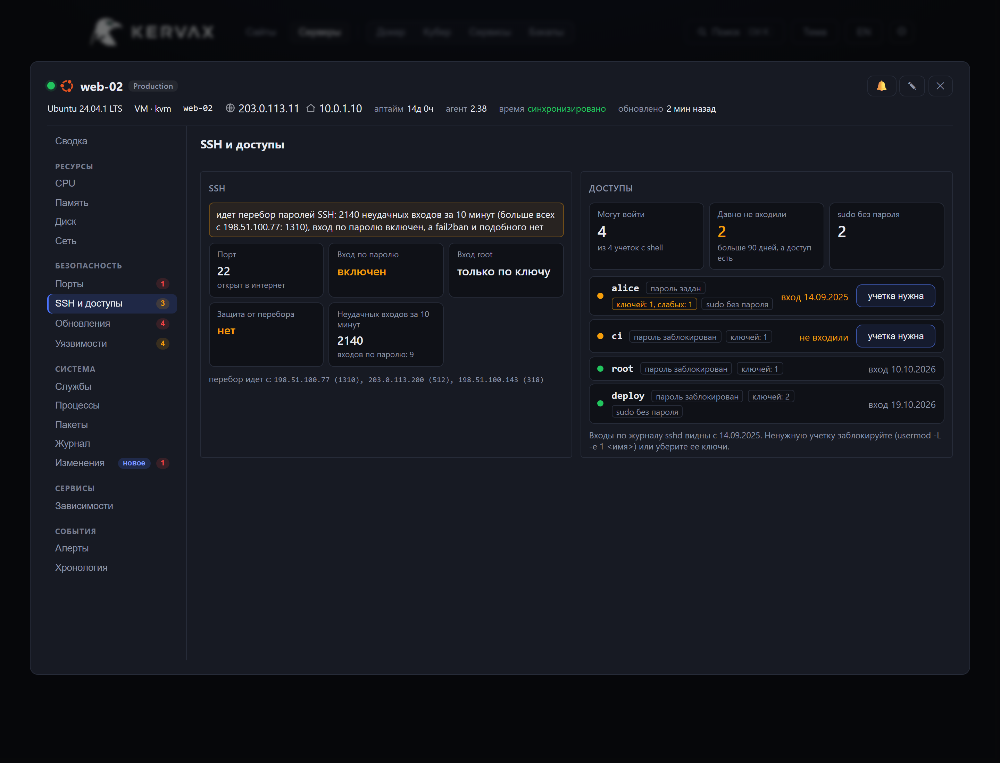</a><br><sub>SSH, учетки, ключи, sudo</sub></td>
</tr>
</table>

- **Открытые порты.** Панель сканирует каждую ноду снаружи и сверяет результат с тем, что слушает
  внутри. У каждого открытого порта видны процесс и контейнер. Порт, открытый только белому списку,
  открытым в интернет не считается. Проверяется, что origin за Cloudflare отвечает только ему.
  Новый порт в интернете - алерт, порт, открытый намеренно, отмечается один раз.
- **SSH.** Вход по паролю, вход под root, порты, защита от перебора, версия в баннере. Судится
  только порт, который проверка снаружи видит открытым.
- **Учетки и ключи.** Кто может войти и с какими ключами, у кого sudo, слабые ключи, учетки, в
  которые давно не входят. Новые пользователи, ключи и правила sudo - алерт.
- **Изменения.** Новые и пропавшие порты, контейнеры, пользователи, правила sudo и кроны в хронологии
  сервера за 90 дней.
- **Уязвимости.** Установленные пакеты по базе OVAL от Canonical. Только критичные CVE и те, что в
  CISA KEV (эксплуатируются в атаках). Ядро сверяется по запущенной версии.
- **Версии без поддержки.** Релизы ОС и версии ПО (PostgreSQL, MySQL, Redis, nginx, PHP, Node.js,
  Python и другие) по снимку endoflife.date, без доступа в интернет.
- **Контейнеры.** Привилегированные контейнеры, ключи хоста и сокет Docker внутри, порты, которые
  обходят фаервол хоста, устаревшие образы внешних прокси.
- **Веб-серверы.** Сертификаты, которые отдает nginx, и `nginx -t` раз в 15 минут: сломанный конфиг
  виден до того, как следующий reload положит сайты.
- **Сама панель.** Блокировка адреса после неудачных входов с белым списком, алерт на отказы и флуд
  к API, TOTP, журнал всех действий.

<table>
<tr>
<td width="50%"><a href="docs/img/ru/vulns.png">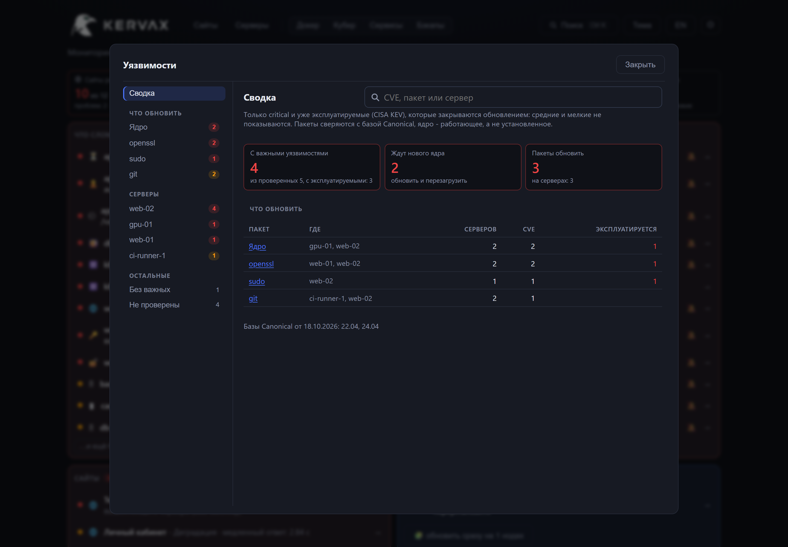</a><br><sub>Уязвимости по всему парку: только критичные и CISA KEV</sub></td>
<td width="50%"><a href="docs/img/ru/server.png">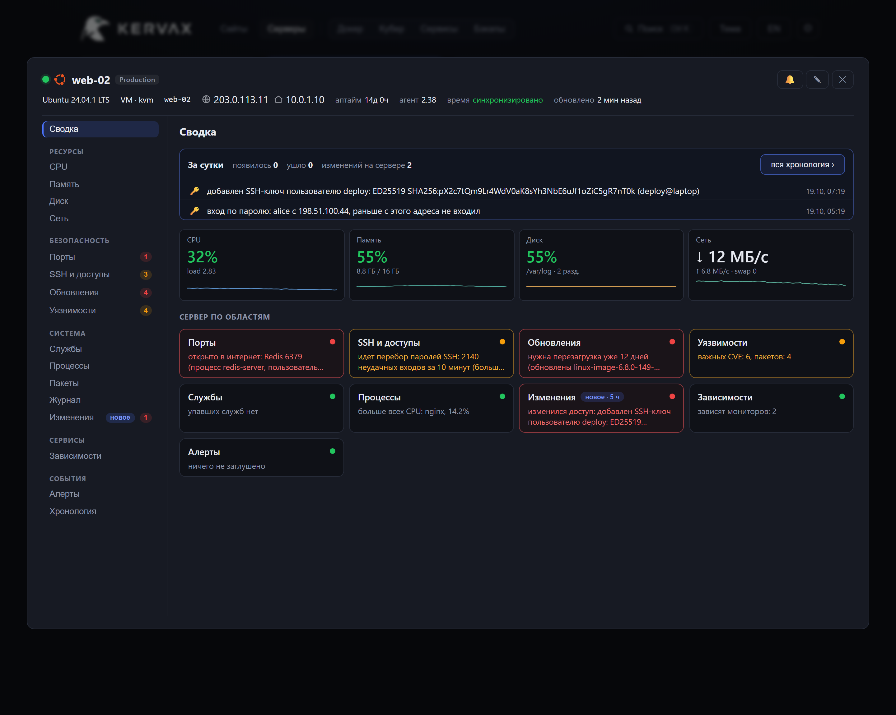</a><br><sub>Карточка сервера: замечания по разделам, изменения за сутки сверху</sub></td>
</tr>
</table>

## Диски и железо

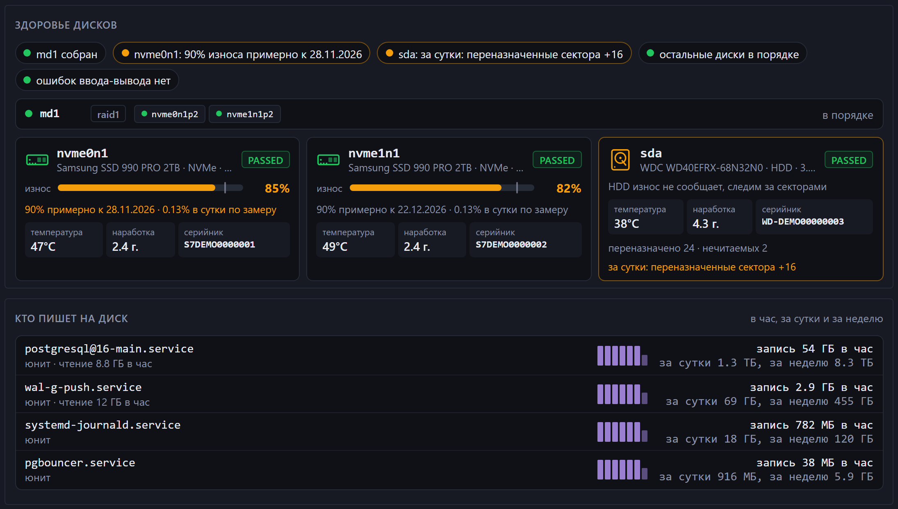

- **Прогноз износа SSD.** Износ NVMe и SATA, дата, когда он дойдет до 100% при текущей записи,
  алерт за 60 дней, процессы и контейнеры, которые пишут больше всех.
- **Здоровье дисков.** Деградировавший RAID, отказ по SMART, растущие счетчики ошибок, пропавшие
  диски, всплески ошибок ввода-вывода в журнале ядра, диски виртуальных машин.
- **Прогноз заполнения.** Через сколько дней кончится место, по суточным минимумам, а не по
  всплескам. Inode отдельно.
- **На что ушло место.** Крупные каталоги, журнал, образы и кэш сборки Docker, разросшиеся логи.
  Безопасное освобождается одной кнопкой, по желанию автоочистка на пороге предупреждения.
- **CPU и память.** Нагрузка по контейнерам и подам (cgroups), утечки памяти по устойчивому росту,
  OOM, давление на ресурсы (PSI), юниты в цикле перезапусков, юниты, которые не запустятся после
  перезагрузки.
- **Сеть.** TCP-проверки между серверами, трафик по контейнерам, трафик за месяц против лимита
  тарифа, задержка DNS-резолверов, сдвиг часов.
- **GPU и LLM.** Загрузка NVIDIA, память, температура, питание, ошибки Xid, после которых нужен
  сброс, застывшие показания. vLLM, SGLang, TEI и LiteLLM: очередь, KV-кэш, время до первого токена.

<table>
<tr>
<td width="50%"><a href="docs/img/ru/disks.png">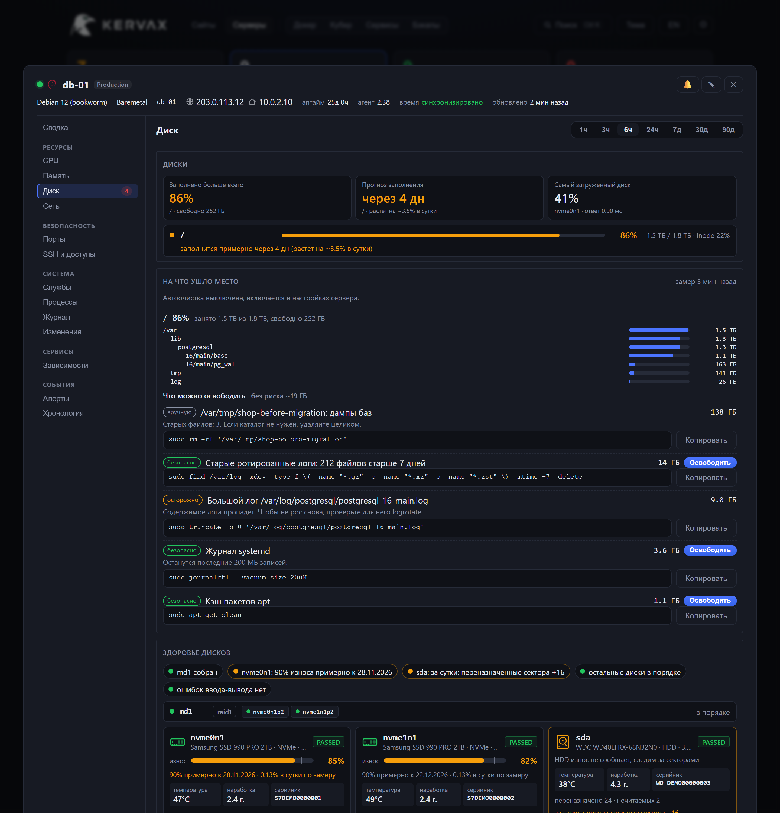</a><br><sub>Прогноз заполнения и на что ушло место, безопасное чистится кнопкой</sub></td>
<td width="50%"><a href="docs/img/ru/gpu.png">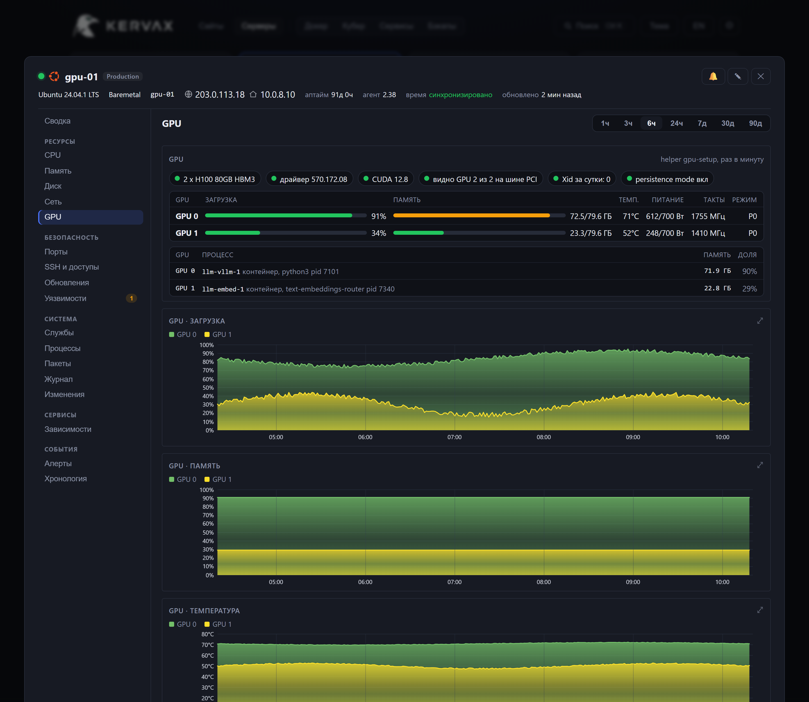</a><br><sub>GPU: загрузка, память, температура, питание, процессы</sub></td>
</tr>
</table>

## Сервисы

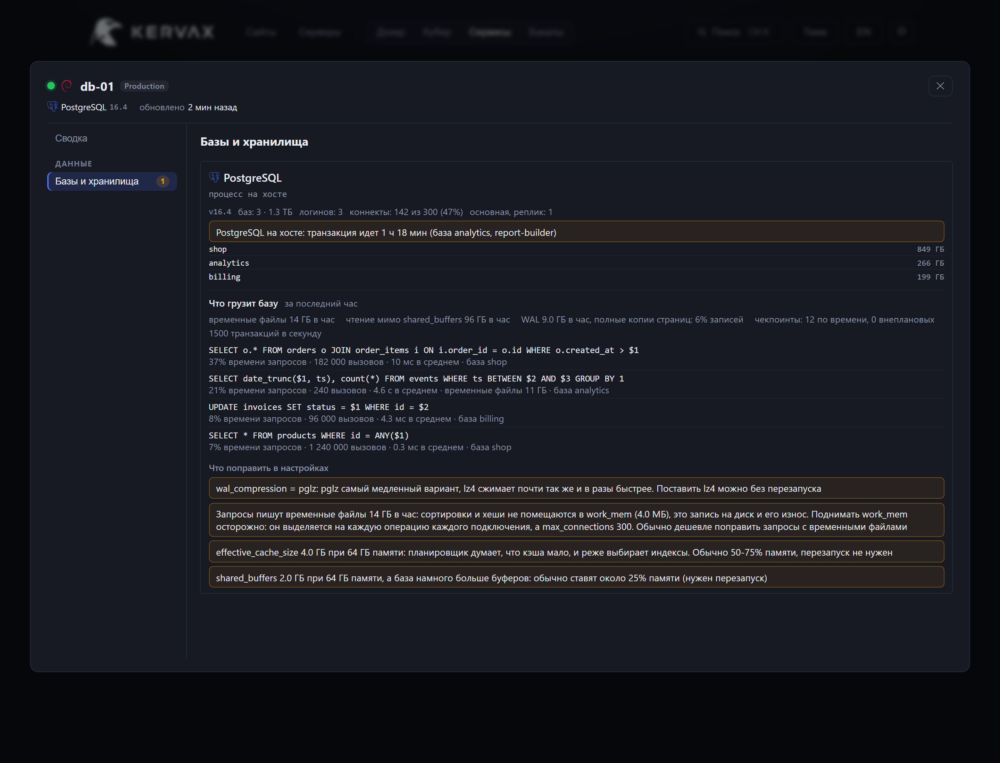

Находятся агентом, настраивать каждый сервис не нужно.

- **Docker и Kubernetes.** Контейнеры, поды, перезапуски, CrashLoopBackOff, упавшие Job с концом
  лога, поды без лимитов и проб, давление на нодах.
- **Сроки Kubernetes.** Сертификаты control plane и kubelet, kubeconfig, TLS-секреты, доступы Flux
  к Git, вставшая доставка Flux. Считается на ноде, ключи ее не покидают.
- **Веб-серверы.** nginx, Apache, Caddy, Traefik, Envoy, HAProxy и их домены. Запросы в минуту и 5xx
  по сайтам и путям. Для 502/504 - какой upstream не ответил и как: отказ, таймаут, нет живых
  серверов, очередь сокета полна.
- **Базы.** PostgreSQL, MySQL/MariaDB, ClickHouse, Redis: размеры, подключения, топ запросов по
  нагрузке, репликация, советы по настройкам.
- **Очереди.** RabbitMQ, списки Redis, таблицы задач в PostgreSQL и MySQL: глубина, потребители,
  возраст самой старой задачи, всплеск упавших. Алерт, когда очередь растет и ее никто не разбирает.
- **Воркеры, кроны, логи, PHP-FPM.** Падения воркеров supervisor и pm2 отдельно от плановых
  перезапусков, кроны, которые наслаиваются, висят или выбрасывают вывод, всплески ошибок в логах
  контейнеров и подов, пулы PHP-FPM, упертые в `pm.max_children` или в таймаут.

<table>
<tr>
<td width="50%"><a href="docs/img/ru/services-app.png">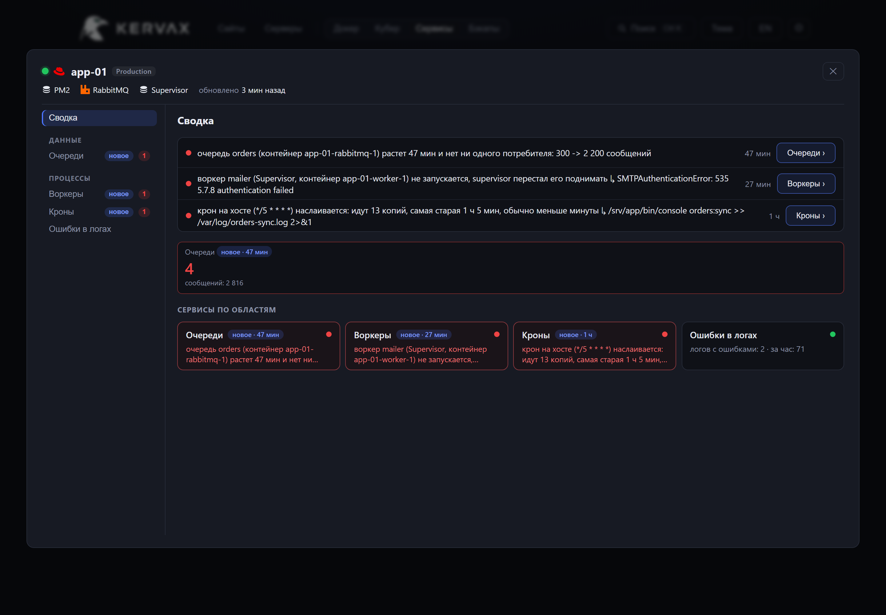</a><br><sub>Очереди, воркеры и кроны: что встало и почему</sub></td>
<td width="50%"><a href="docs/img/ru/kube.png">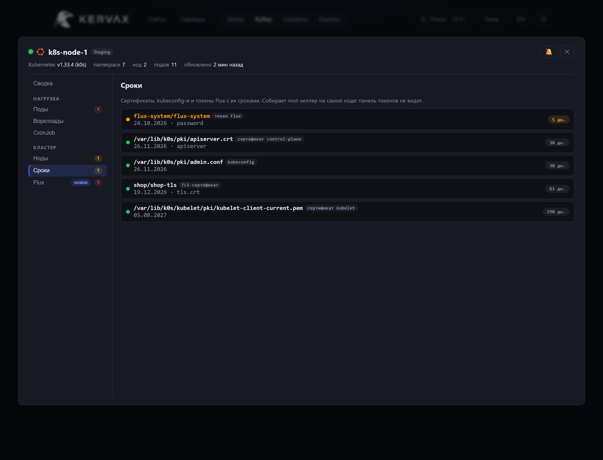</a><br><sub>Kubernetes: сроки сертификатов, kubeconfig и токенов Flux</sub></td>
</tr>
</table>

<table>
<tr>
<td width="50%"><a href="docs/img/ru/web.png">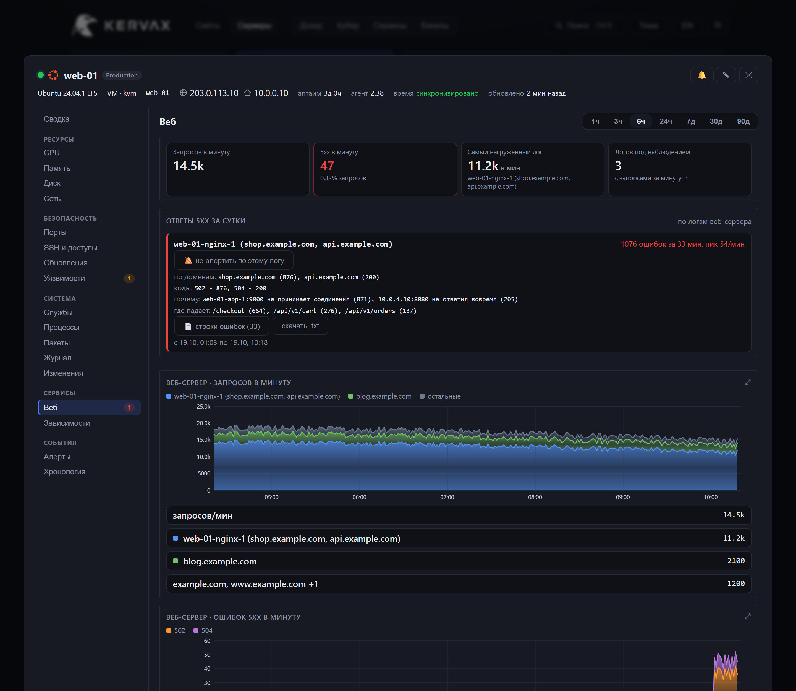</a><br><sub>Веб: 5xx по сайтам и путям, какой upstream не ответил и как</sub></td>
<td width="50%"><a href="docs/img/ru/llm.png">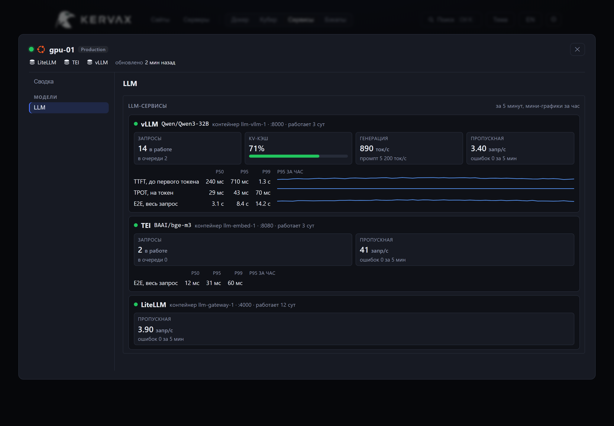</a><br><sub>LLM-сервисы: очередь, KV-кэш, TTFT и TPOT по перцентилям</sub></td>
</tr>
</table>

## Сайты

<table>
<tr>
<td width="50%"><a href="docs/img/ru/sites.png">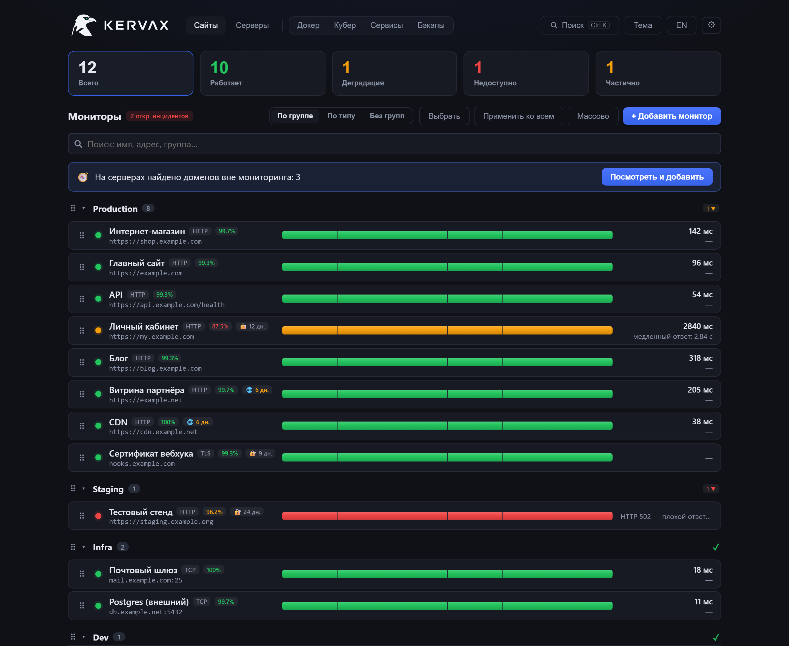</a><br><sub>Мониторы: статус, сертификаты, домены, локации</sub></td>
<td width="50%"><a href="docs/img/ru/site-detail.png">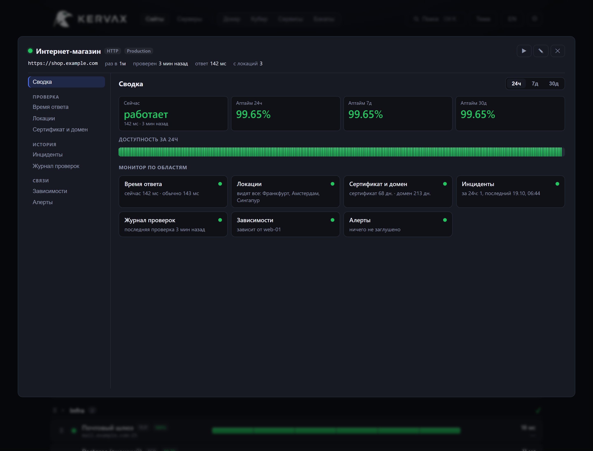</a><br><sub>Карточка монитора: отклик по локациям, инциденты</sub></td>
</tr>
</table>

- HTTP(S) с ожидаемым кодом и ключевым словом, TCP, DNS-записи, push-мониторы (heartbeat).
- Проверка через прокси-локации в других сетях: "недоступен из Сингапура" - отдельное состояние.
- Сроки TLS и регистрации домена, сгруппированные по домену, который продлевают.
- Сайты за белым списком проверяет агент изнутри сервера.
- Сайт, который отвечает через раз, так и называется.

## Бэкапы

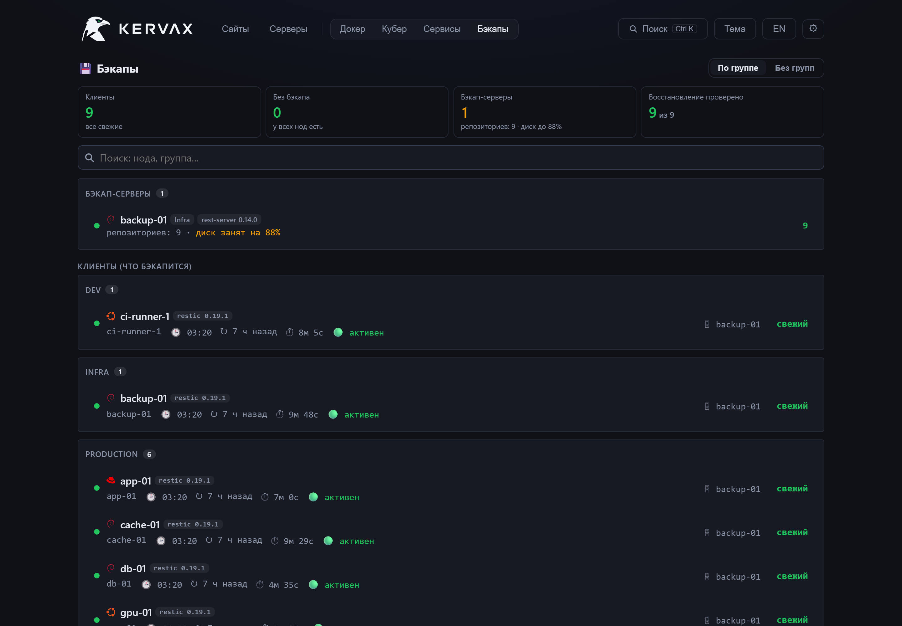

- restic на каждой ноде: последний снимок, результат, ночное окно, сколько добавляет прогон.
- Пробное восстановление раз в неделю, висячие локи, тихо вставшая ротация.
- Сервер бэкапов и клиенты разворачиваются из панели, дампы баз перед каждым прогоном.
- Доступы для восстановления в сейфе, который шифруется в браузере: панель хранит только шифротекст.

## Алерты

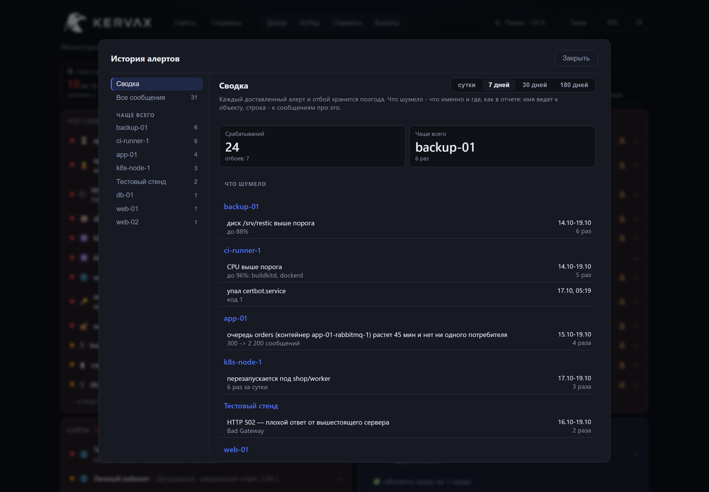

- Telegram с кнопками (заглушить, взял, "это мы") и командами бота, webhook.
- Чаты по группам, эскалация, если никто не взял.
- Окна обслуживания со сверкой после окна, карта зависимостей: алерты серверов за упавшим шлюзом
  придерживаются.
- Одна беда - одно сообщение, один сбой на нескольких серверах - одно сообщение, плановая ежедневная
  нагрузка (ночной бэкап грузит диск) распознается и не алертит.
- История алертов с рейтингом шума, отчет за период с простоем по дням.

## Модель безопасности

- Агент подключается **наружу** по HTTPS. Панель никогда не подключается к серверам и хранит только
  SHA-256 токена агента.
- Роли и группы проверяются в API. `ops/audit_live.py` проверяет живую панель временными учетками
  каждой роли, `ops/selfcheck.py` работает в CI и как pre-commit хук.
- Ничего не работает от root: бэкенд uid 10001, непривилегированный nginx во фронте,
  `no-new-privileges`.
- Со слабым или дефолтным секретом панель не запускается. Пароли от 12 символов, TOTP, блокировка
  перебора, журнал действий.
- Обновления агента подписываются **офлайн**-ключом. Взломанная панель не выкатит на ноды свой код.
- Root-helper'ы на нодах ставит ваш Ansible или вы сами, панель их не рассылает.

Модель угроз: [docs/security.md](docs/security.md).

## Kervax и стек на Prometheus

| Задача | Kervax | Обычный стек |
| --- | --- | --- |
| Метрики нового сервера | одна команда на ноде | node_exporter, scrape-цель, перезагрузка конфига, дашборд |
| Сайт снаружи | адрес | blackbox_exporter, relabeling, правило, панель |
| Сроки TLS и домена | сами, за 14/7/1 день | проба и PromQL, для доменов свой экспортер |
| Порты, открытые в интернет | проверка снаружи, алерт на новый | отдельный сканер |
| CVE и ПО без поддержки | по каждой ноде, в карточке | отдельные инструменты |
| Износ SSD, SMART, RAID | по каждому диску, с прогнозом | smartctl_exporter и правила |
| Контейнеры, поды, базы, очереди | находит агент | cAdvisor, kube-state-metrics, экспортер на каждую СУБД |
| Бэкапы | статус restic и пробное восстановление | не покрыто |
| Инциденты и маршруты | встроены | конфигурация Alertmanager |
| Права доступа | роли и группы в API | организации Grafana и доступ к Prometheus |

Prometheus остается инструментом для прикладных метрик и PromQL, оба работают рядом.
[Чего Kervax сознательно не делает](docs/why.ru.md).

## Требования

- Linux с Docker и Compose, 2 ГБ памяти, порты 80 и 443 (или свой обратный прокси).
- Агент: Linux x86-64 или arm64, systemd.
- Внешние сервисы не нужны.

## Установка и настройка

[docs/install.ru.md](docs/install.ru.md): свой домен, белый список, работа за существующим прокси,
обновление. Настройки - переменные окружения `KERVAX_*`, см. [.env.example](.env.example).

## Масштабирование

Один контейнер держит несколько сотен серверов. `compose.scale.yml` запускает API несколькими
воркерами uvicorn, а планировщик - отдельным процессом:

```sh
docker compose -f compose.yml -f compose.scale.yml -f compose.caddy.yml up -d --build
```

PostgreSQL в `compose.yml` настроен под временные ряды, при росте образ меняется на TimescaleDB.

## Подписанные обновления агента

Выключены по умолчанию. Релизы подписываются офлайн, агент ставит обновление, только если подпись
верна, версия новее и SHA-256 совпадает. Раскатка с канарейкой со страницы серверов.
[docs/agent-releases.md](docs/agent-releases.md).

## Самоконтроль

Планировщик раз в минуту пишет пульс, `ops/panel-watchdog.sh` на хосте сам алертит, если встала
панель, планировщик, база или канал алертов.

## Разработка

```sh
cd backend && python -m venv .venv && . .venv/bin/activate && pip install -e .[dev] && pytest -q
cd ../frontend && npm ci && npm run dev
```

FastAPI, SQLAlchemy 2 async, Alembic, PostgreSQL; React 19, Vite, TypeScript; агент на Go.
`python docs/make-shots.py` пересобирает скриншоты с живой панели на демо-данных: все имена, домены и
адреса в них вымышлены (RFC 2606, RFC 5737).

## Лицензия

[AGPL-3.0](LICENSE).
